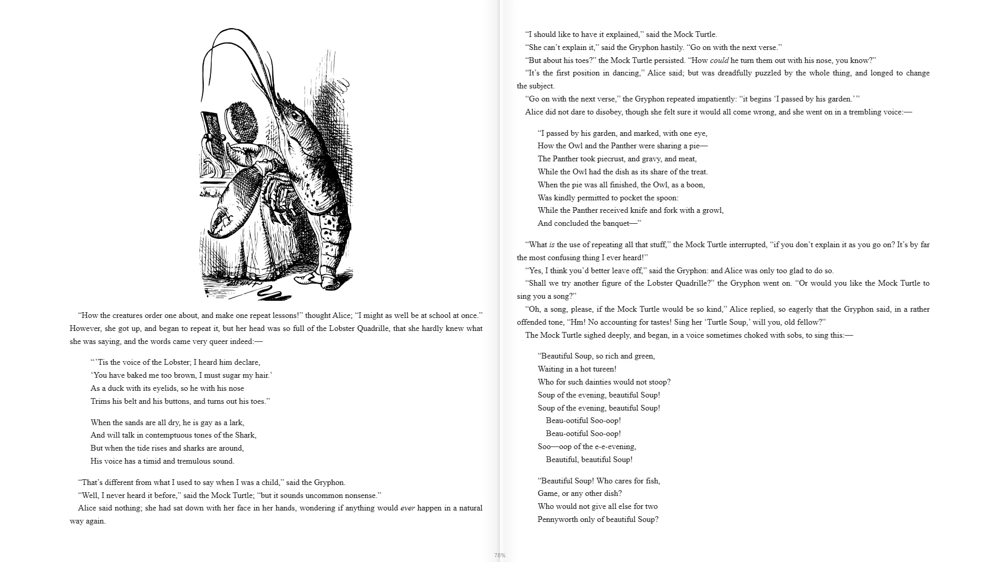

# WittyInk

The study and handwriting toolkit behind WittyEbook, WittyPDF and WittyComics. You don't open it on its own: the readers use it, in WittyMediaServer and in the WittyReader app.

<!-- pictures -->



<sub>WittyEbook, which takes its study tools from here. Text and cover from [Standard Ebooks](https://standardebooks.org/), [CC0](https://creativecommons.org/publicdomain/zero/1.0/).</sub>

<!-- /pictures -->

## What it does

- **Highlights in any colour,** and you can name what each colour means. The names show in filters and exports.
- **A notes panel:** every highlight, note, bookmark and handwritten page, filtered by kind, colour or text.
- **Definitions and citations,** with citations in the form *"quote" (Author, Title (Year), p. 12)*.
- **Markdown export** of all your notes, grouped by chapter or page.
- **A pen with pressure:** pen, pencil, highlighter and eraser. The pen's eraser end and side button erase, and fingers turn pages once a pen has touched the screen.
- **Undo and redo** with Ctrl+Z and Ctrl+Y, for highlights and handwriting.
- **The reader host:** one interface, `ReaderHost`, that connects a reader to the app around it, so the same reader saves to a server in one app and to the device in another.

The Reader page, and the host it provides, stay with the server.

How to use it is in **Help** inside WittyMediaServer: see Books, PDFs and comics.

## How to get it

An admin adds it from the module store inside WittyMediaServer: **Settings → Modules**, then **Browse the store**, then **Add** beside WittyInk. That needs WittyMediaServer 0.6.0-alpha or later, and it works with nothing older. The range this version fits is in `module.json`: 0.6.0-alpha through 0.6.x.

The store brings it when you add a reader.

## What it needs

React 18 or newer, which the app provides. It has no other dependencies.

## Platforms

It's one browser bundle for every system the server runs on, and it runs on whichever device opens the server. It has been seen working inside the readers in a desktop browser, against a test server on Linux. It also runs in the WittyReader app. Safari, real phones and real TVs have not been tried.

## Building and testing

You need Node.js 22, as CI uses, and Go for the manifest check. In a worktree, first run the copy of `dev-modules.mjs` kept above the repositories (`node D:/projects/dev-modules.mjs` on the development machine). It writes only links that git ignores, so the checkout builds against the repositories beside it.

```bash
npm install
```

```bash
npm run build:bundle
```

That makes one script and one stylesheet, as a server installs them. To check the manifest:

```bash
go run github.com/wittywilla/wittymodule/cmd/wittymodule check .
```

It has no tests of its own yet. CI checks the manifest and builds the bundle.

To use it in another app, wrap a reader in `HostContext.Provider` with a `ReaderHost`. The guide for developers is in [wiki/](wiki/Home.md): [Reader host](wiki/Reader-host.md), [Building blocks](wiki/Building-blocks.md) and [Styling](wiki/Styling.md).

## Licence

GNU Affero General Public License v3.0 (or later): see [LICENSE](LICENSE) and [NOTICE](NOTICE). If you redistribute it or build on it, please keep the NOTICE attribution.


## In every app: its server-driven UI

It carries the pages a server shows for books, in its own `sdui.json`, made of the server's catalogue so every app draws them in every look:

- **A books library** (`wittyink-library`): Continue reading, then the bookshelf. The web and desktop apps draw the bookshelf (`wittyink.bookshelf`): Books, Series and Authors, sorting, All, Reading or Finished, books, PDFs or comics, and find. Televisions and phones get every cover in a grid.
- **Books** (`wittyink-books`): Continue reading, then what's new in each books and audiobooks library.
- **A book's page** (`wittyink-book`): Read, Continue reading or Read again, Download, Share, and more like it.
- **Settings, Reading** (each profile's own): handwriting, and what each highlight colour means.
- Two rows for the page editor's gallery: Continue reading, and new books in each library.

**Stays in WittyInk's own code:** the reading tools themselves (highlights, notes and their export, handwriting, definitions) inside the readers, and the bookshelf on the web.

The file is checked with `wittymodule check` and described in WittyMediaServer's [docs/SDUI-MODULES.md](https://github.com/wittywilla/WittyMediaServer/blob/master/docs/SDUI-MODULES.md).

## Legal

WittyInk is an independent open-source project. It isn't associated with, sponsored by or endorsed
by any publisher, rights holder, service or other media software project. It doesn't provide or
check the books you open with it. Any third-party names here only describe what it works with, and
belong to their owners. It's provided “as is”, with no warranty; see [LICENSE](LICENSE). Local law
applies to how you use it. This isn't legal advice.

<!-- module-kit -->
## Releasing

A version tag builds the bundle for the browser, signs the checksum list, and publishes a release that servers can install.

Versions move in small steps as work lands. `go run github.com/wittywilla/wittymodule/cmd/wittymodule@v0.4.0 bump .` raises it
everywhere it is written (add `-part minor` for a bigger step). A bump isn't a release: nothing is
tagged or published until you tag it. CI fails when code changed since the last tag and the version
didn't, because tags never move.

To release:

1. Check that `version` in `module.json` is the one to publish, with the bump committed.
2. Tag that commit and push the tag: `git tag vX.Y.Z`, then `git push origin vX.Y.Z`. A tag with a
   suffix, such as `v1.2.0-beta`, is published as a prerelease.
3. Watch the *Actions* tab. The signing step uses the `WMS_SIGNING_KEY` secret of the `release` environment, and nothing is published without it.

To take a version back, run the *withdraw* workflow from the *Actions* tab. It adds the version to a signed list on the release tagged `withdrawals`, which servers read.

Licensed under AGPL-3.0-or-later: see [LICENSE](LICENSE) and [NOTICE](NOTICE).
<!-- /module-kit -->
